# 用药助手\-老人端PRD

用药助手 老人端产品需求文档

|**项目**|**内容**|
|---|---|
|文档版本|V1\.0  原型说明稿|
|日期|2026\-11\-08|
|范围|老人端「今日」「计划」「我的」三个页面及其子流程|
|设计依据|「老人端设计」文件夹中的高清原型、组件状态、功能教程和补充说明|

# 概要

用药助手面向需要长期服药的居家老人。主页面包含三个一级入口用户，在「我的」入口维护常用药，在「计划」入口设置时间、重复日程与单次剂量，在「今日」入口核对当日当次用药、记录结果并查看进度。

需要家人协助时，可从今日页或记录页打开联系家属入口。\(家属端待补充\)

## 用户标签

|**角色**|**典型场景**|
|---|---|
|独立管理用药的老人|每天按多个时段服药，需要确认当前吃什么、吃多少，以及是否已经记录。|
|与家属共同管理的老人|家属协助录入或核对安排，老人日常查看计划和记录结果。|
|协助操作的家属|帮老人维护药品和计划，或在老人遇到疑问时提供协助。本篇入口在老人端。|

## 用户需求与调研补充

|**用户需求**|**原型中的对应功能**|
|---|---|
|知道今天该吃什么药、吃多少。多重用药、多时段用药容易混淆的情况下，需要按次核对时间、药品、剂量和结果。|今日任务卡、今日进度、用药记录|
|忘记服药或误点时能补记、撤销。记录后要能识别当前状态，也要能回退到默认状态。|二次确认、漏服记录、撤销按钮|
|减少重复输入，调整计划时能核对。常服药品集中维护，再按时段选取|我的常用药、计划药品下拉、时间与重复滚轮|
|字看得清，遇到问题找得到家人。考虑视力、操作熟练程度和家人协助的差异。|大字与字号设置、逐句朗读和高亮、联系家属和联系人置顶。|

以上需求方向支撑来自产品调研报告中用户存在的记忆负担、多重用药和数字素养能力缺失的需求。

## 产品架构

|**一级入口**|**页面与主要任务**|
|---|---|
|今日|今日进度与用药卡片 → 用药／漏服确认、撤销、用药记录、联系家属|
|计划|每日计划与计划卡片 → 修改每日时段、添加／编辑／删除计划、选择药品与剂量|
|我的|姓名与头像 → 我的联系人、用药提醒、我的常用药、设置|

使用路径：「计划」中选择药名并填写本次剂量→「今日」按时段生成任务→确认已用药或漏服→更新「今日」状态与完成进度。

**名词约定**

「常用药」保存常用药品的名称、用药日常和单词用药剂量，设置用药计划时可一键选择已添加药品使用规则。

「用药计划」保存一个时段的用药时间、日程及药品名称和剂量，结果同步今日计划。

「用药任务」包含当日需要服用药品时间、名称、剂量，一般用作当日打卡和查看服药情况。

# 功能清单

|**编号**|**页面**|**功能**|**主要结果**|
|---|---|---|---|
|T01|今日|今日任务与进度|看到当日需服药的时间、药品、剂量及完成次数|
|T02|今日|用药确认与撤销|核对后记录已用药，误点可恢复待处理|
|T03|今日|漏服确认与撤销|记录已漏服，卡片独立显示，完成数不增加|
|T04|今日|查看用药记录|按日期查看完成次数|
|T05|今日|联系家属|选择联系人并查看号码|
|P01|计划|计划列表与删除|浏览计划卡片，删除后显示对应空位|
|P02|计划|新建与编辑计划|保存时间、重复日程和药品剂量|
|P03|计划|选择常用药与填写剂量|每行从最新常用药名单选择药名|
|P04|计划|调整每日时段|修改、移除或恢复早、午、晚、睡前时段|
|M01|我的|个人信息与姓名|从姓名入口编辑并保存|
|M02|我的|联系人列表与详情|查看号码、置顶或取消置顶|
|M03|我的|添加联系人|保存称呼和电话号码|
|M04|我的|用药提醒开关|控制待处理卡片的「忘记服药」入口|
|M05|我的|管理常用药|添加、编辑和长按删除|
|M06|我的|字号设置|即时切换标准、大号、特大|
|G01|全局|底部导航|在三个主页面间切换|
|G02|全局|语音朗读|顺序朗读并高亮当前内容|

# 今日

## T01 今日任务与进度

|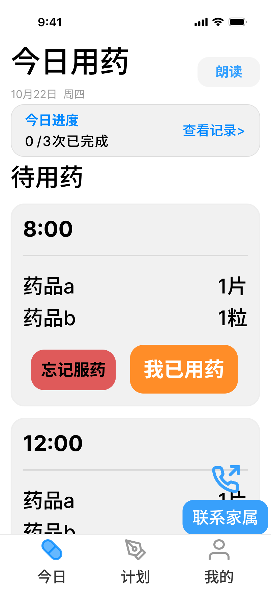 今日用药首页|- 打开预览默认进入「今日」。页首固定显示日期、朗读、今日进度和「查看记录」，下方卡片按时间从早到晚排列。 - 每张卡显示时间、餐后或睡前标签，以及药名和该次剂量。演示初始启用 08:00、12:00、18:00，睡前 22:00 可添加。 - 进度分子为已用药任务数，分母为当日任务数。添加或删除生效计划后重新计算。当天无任务时显示「请前往『计划』添加」，如右图。 ||
|---|---|---|

## T02 用药确认与撤销

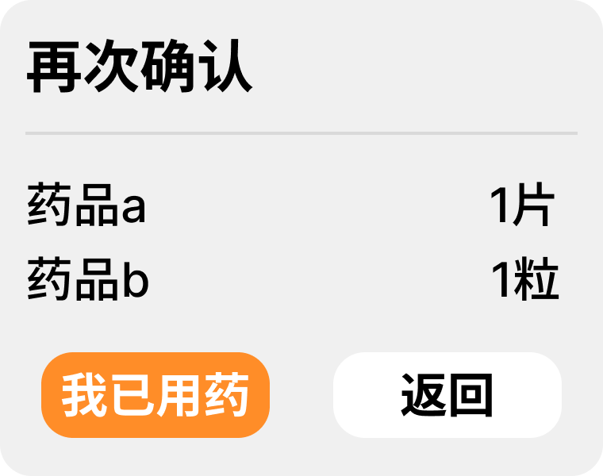

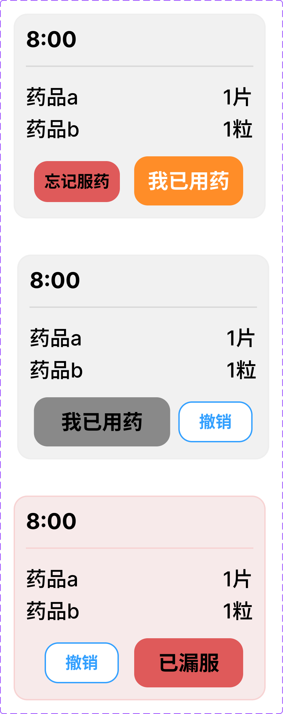

再次确认用药面板 、已用药和已漏服卡片

- 点击「我已用药」打开「再次确认」悬浮窗面板，核对药名和剂量。再次点击「我已用药」后，该任务计为完成，灰色已用药按钮旁保留「撤销」。点击「返回」关闭「再次确认」弹窗。

- 例：初始进度为 0/3，确认第一张卡后为 1/3，撤销后回到 0/3。同一个时段内多种药品合计为一次任务。

## T03 漏服确认与撤销

|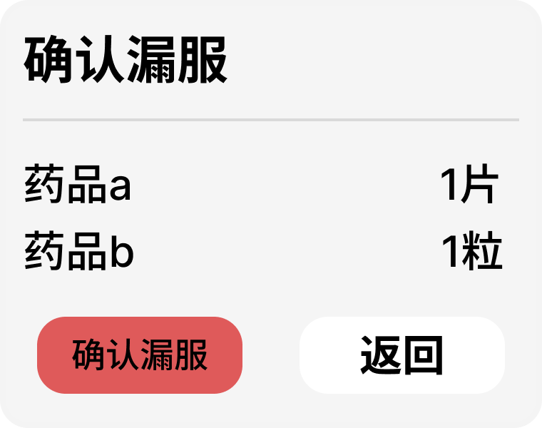 确认漏服面板|- 提醒开启时，待处理卡片显示红色「忘记服药」。点击后核对药名和剂量，选择「确认漏服」或「返回」。 - 确认后卡片显示「已漏服」和「撤销」。已用药与已漏服互斥。撤销后恢复待处理，漏服状态不计入完成次数。 |
|---|---|

## T04 查看用药记录

|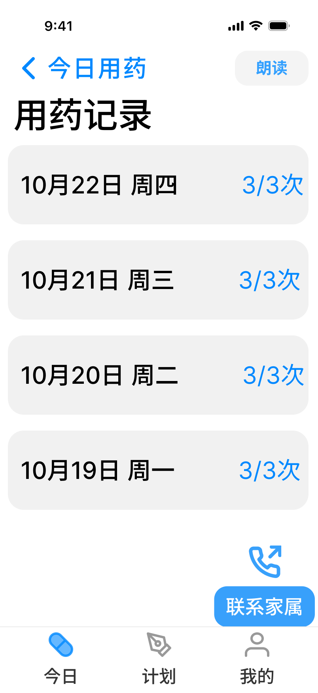 用药记录按日期显示完成次数|- 点击「今日」入口中的今日进度旁的「查看记录」，按日期、星期和完成次数查看。点击左上角返回「今日用药」。|
|---|---|

## T05 联系家属

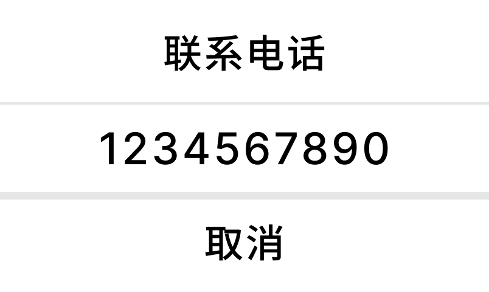

选择联系的家属  /  联系电话底部面板

- 「今日」和「用药记录」页的「联系家属」打开联系人选择面板，可选择联系人取自置顶排序后的前3位，默认显示伴侣、子女。

- 点击选择后联系电话底部面板从底部弹出并固定在底部，点击「取消」关闭。

# 计划

## P01 计划列表与删除

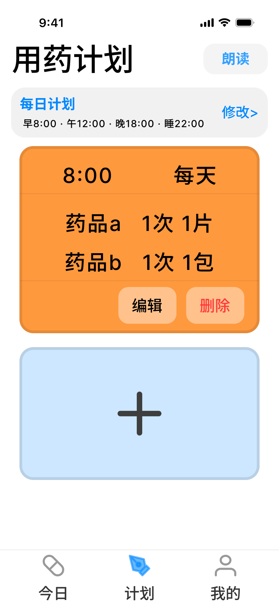

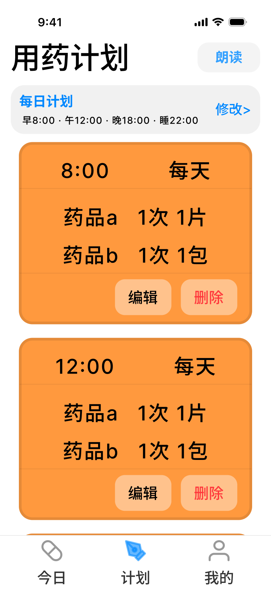

待添加药品空位页和已填计划页

- 页首固定显示「用药计划」及「每日计划」摘要。列表中的橙色卡片显示时间、重复日程、药品与剂量，并提供「编辑」「删除」按钮，浅蓝色卡片表示待添加药品位。

- 删除后对应卡位恢复为加号。该计划若已同步「今日任务」，该任务会同步移除，进度随之更新。

## P02 新建与编辑计划

| 用药计划编辑面板的静态布局|- 点击P01浅蓝色面板新建用药计划，默认一组空白药品。点击P01橙色卡片或「编辑」，回填已保存的内容。 - 编辑面板顶部滚轮设置00:00至23:59及重复日程，可选「仅一次」「每天」「工作日」「周末」。滚动与吸附见 H01。 - 点击「确认」保存。橙色卡片同一行、同字号显示每日用药次数和单次剂量，如「2次 1片」。 - 已编辑计划进入「今日」，额外计划与每日时段时间相同时，优先显示额外计划的药品和剂量。「仅一次」的跨日规则待定义。 - 定义：额外计划指非每日服用药品的计划。相对每日固定服用药品为额外计划。 |
|---|---|

## P03 选择常用药与填写剂量

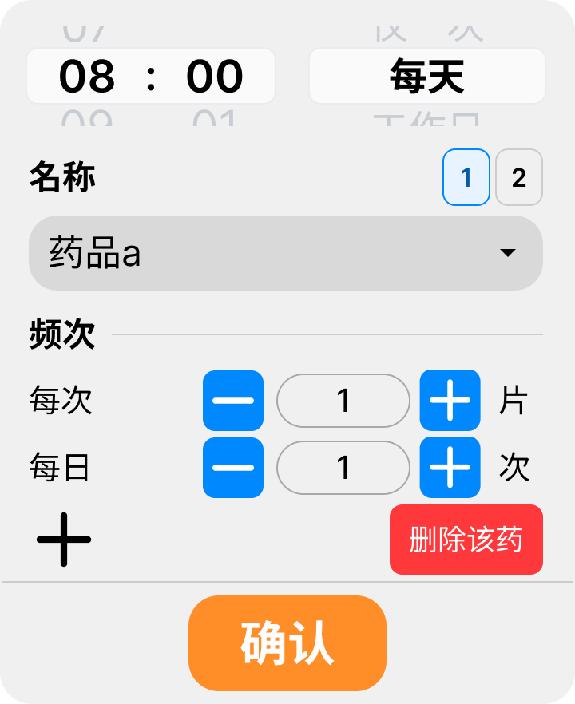

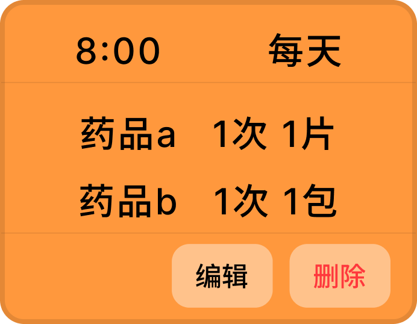

计划中药品栏和剂量栏的位置

- 「名称」手动输入药名，或点输入框右侧的三角选择「我的常用药」，该下拉栏中药品种类与「我的常用药」面板中的药品种类保持同步，编辑面板用药频次与剂量自动写入。

- 「频次」分为包括每日用药次数与每次用药剂量，可用加减按钮调整或直接输入，如「0\.5片」「1粒」，输入框最多3个字符，加减按钮可在 1 至 20 次之间调整。

- 左下方「＋」新增药品，每个计划最多6种。用名称右侧的数字标签切换药品，背景色为蓝色时该药品为选中状态。点击「删除该药」移除当前药品。删除最后一种时保留一组空白输入。

- 确认时忽略未填名称的药品，至少需保留一种，且已填名称的药品必须有剂量。常用药为空时仍可手动输入。常用药改名或删除后，旧计划保留原先保存的名称、剂量和每日次数。

## P04 每日时段

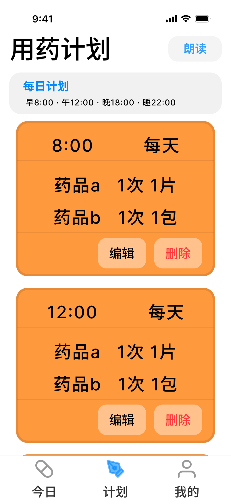

- 「计划」中每日计划下按照当日用药时间自动生成用药时间汇总，便于用户明确当天用药频次与具体时间，当当日用药时间改变时，每日计划随之改变。

- 每日计划下显示时间不可手动更改。

# 我的

## M01 个人信息与姓名

| 我的首页与功能入口|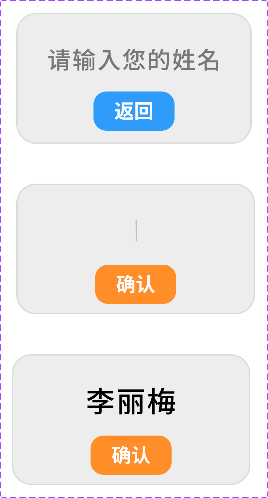 姓名提示、输入和填入状态|- 首页显示姓名、头像、「朗读」以及联系人、用药提醒、常用药和设置四个入口。 - 点击姓名，先打开「请输入您的姓名」提示，再点击提示进入带光标的输入框，输入姓名点击确认后立即更新个人页。姓名最多4字符，去除首尾空格后为空时提示输入。 |
|---|---|---|

## M02 联系人列表与详情

| 我的联系人列表|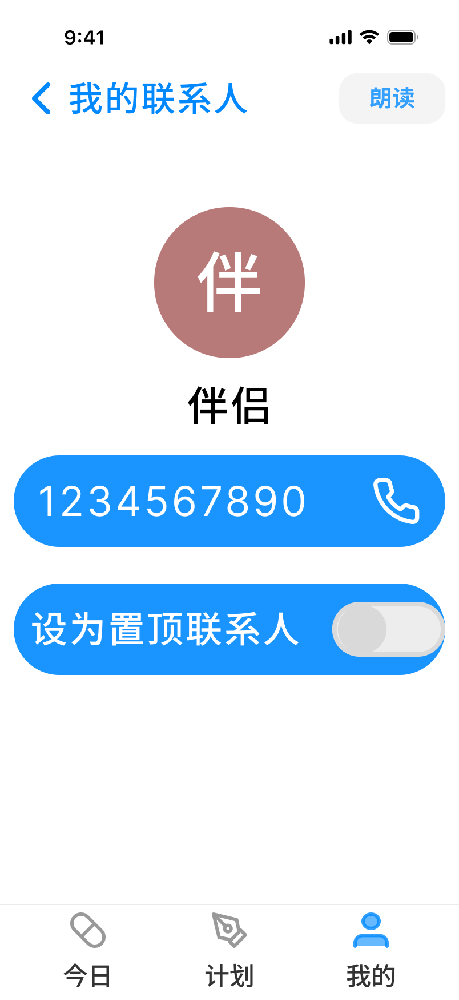 联系人详情、电话和置顶开关|- 从「我的联系人」进入列表，点击目标联系人卡片查看称呼、号码与置顶开关。点击号码打开联系电话面板，样式同T05。 - 同时仅置顶一位联系人。置顶后排在列表和联系家属选择面板首位，再点一次可取消。 |
|---|---|---|

## M03 添加联系人

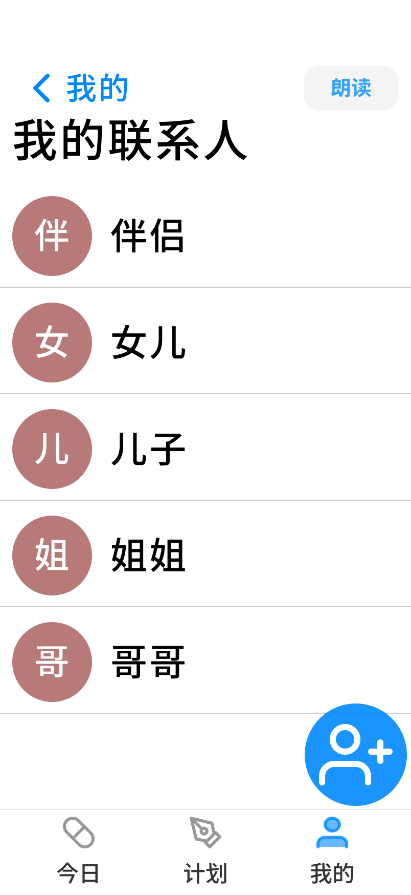

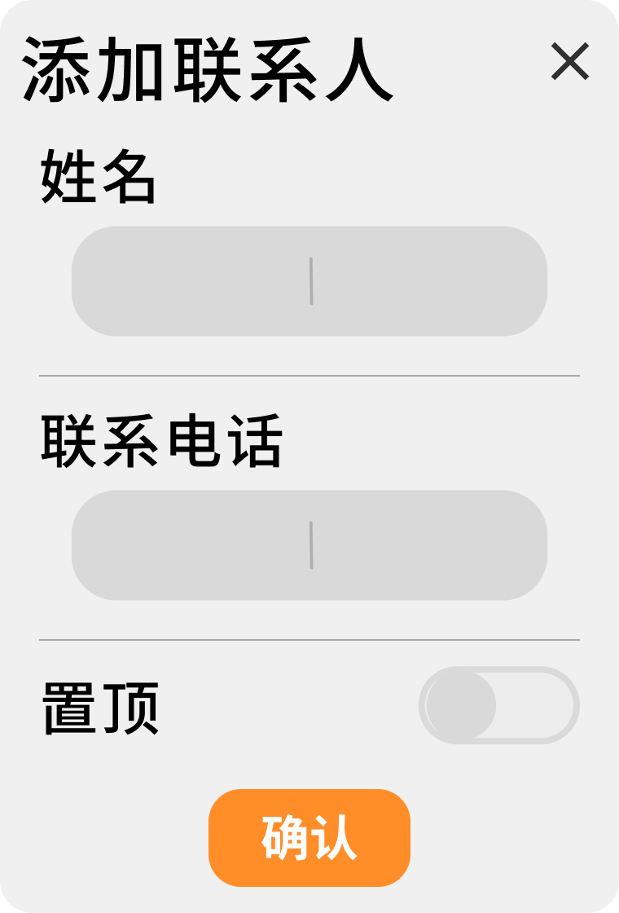

联系人添加入口和添加联系人面板

- 点击列表右下角的添加按钮出现添加联系面板，填写称呼和电话号码。称呼最多8字符，电话号码最多11字符。

- 添加联系人面板可直接将该联系人设为置顶联系人，当列表中已有置顶联系人时，以最新设置的置顶联系人为准，添加联系人面板中的置顶按钮默认关闭。

- 保存成功返回联系人列表，想要更改置顶联系人可点击目标联系人卡片进行更改，

## M04 用药提醒开关

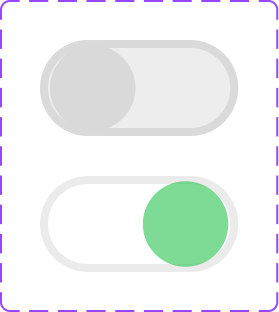

用药提醒关闭与开启

- 在「我的」点击「用药提醒」切换状态，演示默认开启，设置可保存。

- 开启时，系统在每日用药前半小时、前十分钟、用药准确时间发送提醒通知，关闭时系统不再推送用药提醒通知。已记录结果仍可查看和撤销。该开关用于页面内状态演示。

## M05 管理常用药

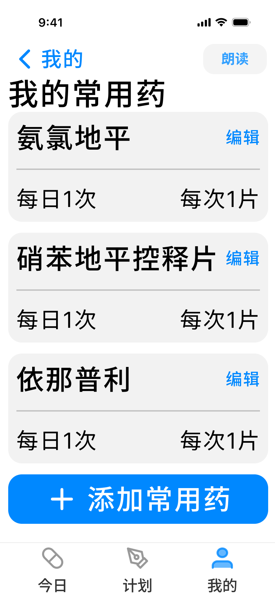

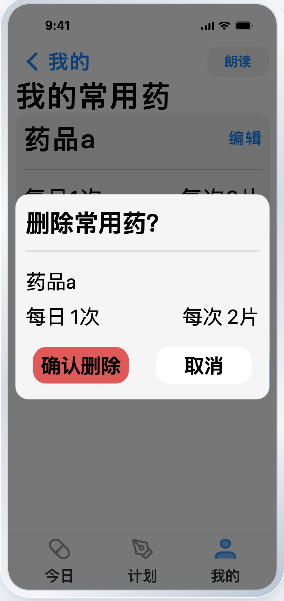

常用药面板、 添加常用药面板、删除常用药面板

- 「我的常用药」的卡片显示药名、每日频次和每次用量。底部「添加常用药」打开表单，卡片的「编辑」回填现有数据。名称必填，最多 18 字符，每次片数与每日次数通过加减按钮在 1–20 间调整。

- 长按单个常用药卡片约半秒，可打开删除确认面板。确认后更新列表。

## M06 字号设置

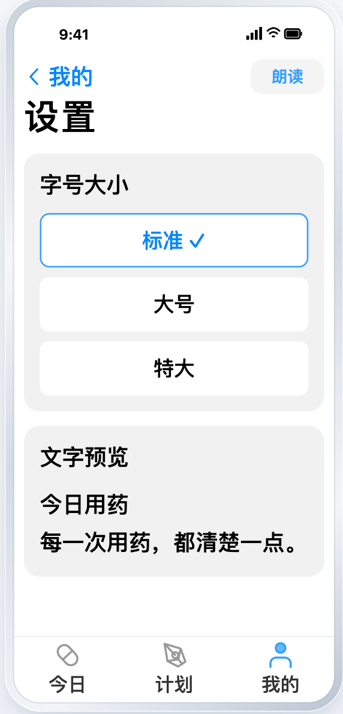

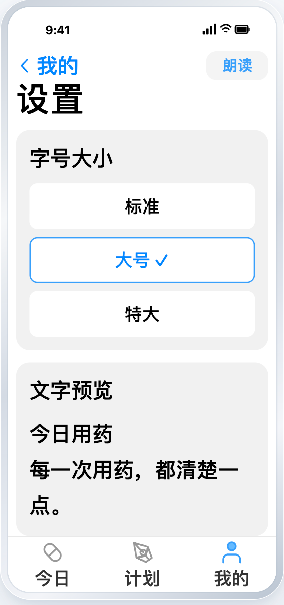

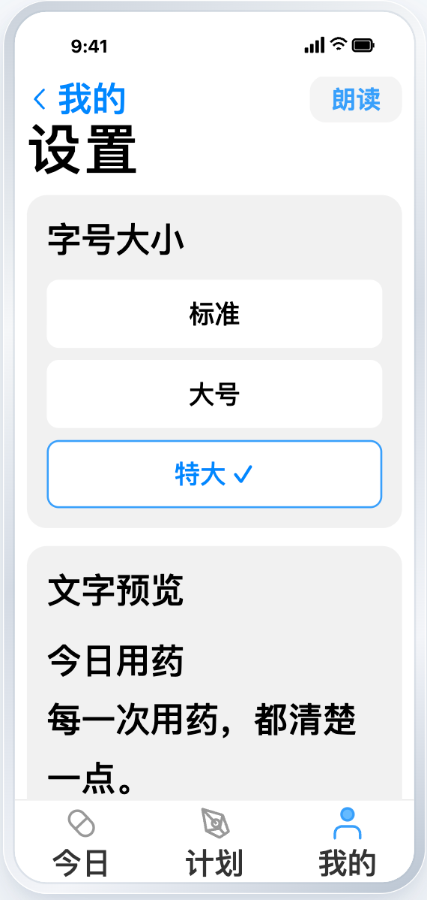

- 「我的 → 设置」提供标准、大号和特大三档，对应 100%、112%、124%。点击即时更新文字预览与页面中受字号设置控制的文字，刷新后保留所选档位。

- 该功能体现在html预览文件中，未在figma原型图中体现。

# 全局说明与非功能需求

## G01 底部导航

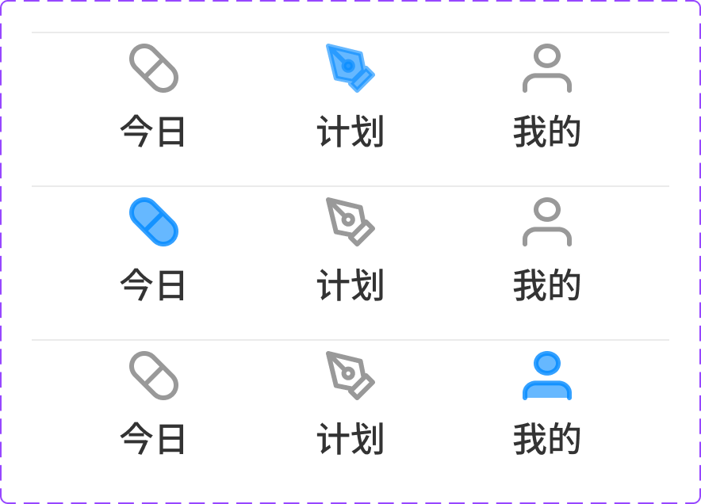

今日、计划、我的三种导航选中状态

- 底部固定显示「今日」「计划」「我的」，蓝色图标标记当前模块。打卡页归入「今日」，用药计划编辑归入「计划」联系人、常用药、设置归入「我的」。子页通过顶部返回按钮回到上级。

- 「今日」「计划」「我的」页首区域随内容滚动保持可见。

## G02 朗读与高亮

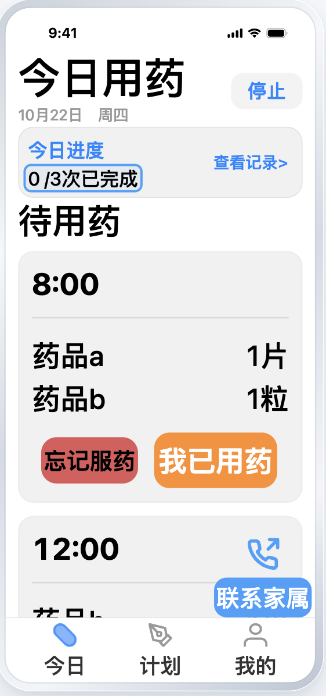

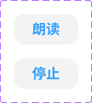

- 点击有「朗读」入口的页面，按从上到下的顺序读取页面标记的内容，如标题、日期、时间、药品和剂量。当前朗读内容以蓝色方框标出，必要时滚动到可见位置。

- 点击「停止」、切换页面或打开弹窗会结束朗读。语音由浏览器与设备提供，语音不可用时仍可展示顺序高亮。

## 视觉与演示数据

|**项目**|**当前规格**|
|---|---|
|设计画布|手机界面 402 × 874，圆角 32 px。提供的整页 PNG 为 804 × 1748|
|关键视觉|主蓝 \#38A0FB、强调蓝 \#0088FF、主操作橙 \#FF8D28、面板灰 \#F1F1F1、\#EDEDED 70%。标准字号下HTML 今日与计划标题 44 px，悬浮窗面板统一宽380px，用药卡片面板宽346px、高269px。|
|预览适配|设备框随可用宽高缩放，页面内容可纵向滚动|
|保存与重置|姓名、计划、联系人、常用药、用药状态和设置保存在当前浏览器。预览外的「重置演示」需确认后恢复初始数据。|
|演示边界|HTML固定演示日为2026\-10\-22 周四。任务用于记录已设定的服药安排。号码展示、页面内提醒和本机语音由当前浏览器演示。|

# HTML 演示清单

## 原型与 HTML 的差异及动态效果

先用浏览器打开项目 HTML。需从初始状态演示时，可在预览外点击「重置演示」并确认。

|**编号**|**观察点**|**HTML 操作与预期表现**|**静态原型对应情况**|
|---|---|---|---|
|H01|时间与重复滚轮|「计划 → ＋／编辑」上下拖动小时、分钟和重复列。相邻项渐隐，松手后吸附到最近一项，中心值为选中项。支持鼠标滚轮、触控和方向键。新增／编辑区高 63 px，中心行 31\.5 px。「每日计划 → 修改」滚轮高 56 px，中心行 28 px|原型图展示停驻值，滑动过程及吸附用 HTML 看|
|H02|顺序朗读与逐句高亮|「今日 → 朗读」，观察蓝框按内容顺序移动并跟随滚动，点击「停止」结束|静态图可补高亮状态，声音和顺序用 HTML 看|
|H03|药品候选联动|「我的 → 我的常用药」新增、改名或删除后，「计划 」任一药品下拉，候选随列表更新。「我的常用药」下点击编辑默认弹出「我的:添加常用药面板」，药品名称、频次自动同步。|原型的计划输入组件以静态输入态表达|
|H04|计划初值与剂量示例|默认三个时段已启用，从末尾加号添加睡前卡，初始为 22:00、每天，可滑动修改。HTML 默认示例中药品b的计划剂量为「1粒」|编辑面板组件展示 00:00、仅一次。计划卡原图中药品b示例为「1包」。整页图片可借组件或录屏查看列表下部|
|H05|卡片结果与进度联动|确认已用药后观察进度和记录首行，再撤销。确认漏服后观察卡片样式，完成次数维持原值|原型提供各卡片状态，切换和数字联动用 HTML或figma演示动画查看，原型记录图示例为 3/3。|
|H06|每日时段与今日列表联动|「计划 → 每日计划 → 修改」，变更时间或移除一行并确认，再回今日核对时间和任务总数。恢复时段后可再次显示||
|H07|真实输入与校验|点击姓名提示进入输入；计划剂量可输入。|原型提供部分输入中间态。光标、键盘和反馈以HTML为准|
|H08|字号、本地保存与提醒|「我的 → 设置」切换特大字号后回今日，再刷新核对保存。关闭提醒后回今日看待处理卡片，随后重新开启|页面内的联动用 HTML 看|

